  <a href="https://github.com/hdnng">
    <picture>
      <source media="(prefers-color-scheme: dark)" srcset="dark_mode.svg" />
      
    </picture>
  </a>

  <picture>
    <source media="(prefers-color-scheme: dark)" srcset="https://raw.githubusercontent.com/hdnng/hdnng/output/github-snake-dark.svg" />
    
  </picture>

  

